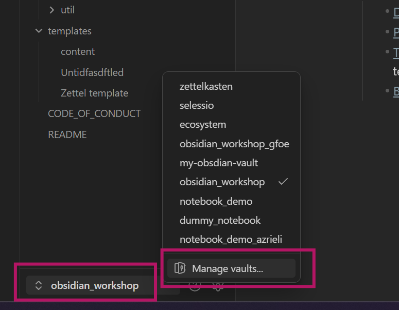

### Description

Notes, paper summaries, ideas and to-do lists tend to pile up across scattered files, hard to search and harder to connect. Obsidian is a free note-taking app that keeps them in one linked, searchable place, stored as plain text files on your own computer.

In this hands-on workshop for researchers (no prior experience needed), you learn to set up and structure your own notebook and link related notes, ideas and papers so they're easy to find again. You also build a daily-note workflow to plan your days and track tasks, and use templates for notes you write often. You leave with a starter setup and materials to build on.

```{=html}
<iframe class="slide-deck" width="780" height="500" src="../slides/2026_10_15_obsidian-basics.html"></iframe>
```

[Slides in full screen](../slides/2026_10_15_obsidian-basics.html){target="_blank"} &nbsp;&nbsp;&nbsp; <a href="../slides/slides_pdf/2026_10_15_obsidian-basics.pdf" download>Download PDF slides</a>

::: {.callout-tip}
## Exercises

Step-by-step guides for the hands-on parts of the workshop:

- [Exercise 1: Obsidian basics](additional_material/21_obsidian-basics/exercise-1-basics.qmd): Create your first vault, write and link notes
- [Exercise 2: Daily notes](additional_material/21_obsidian-basics/exercise-2-daily-notes.qmd): Set up a daily notes workflow with templates and the Calendar plugin
- [Exercise 3: The Tasks plugin](additional_material/21_obsidian-basics/exercise-3-tasks.qmd): Collect tasks automatically in your daily notes

For reference: [Markdown cheatsheet](additional_material/21_obsidian-basics/markdown-cheatsheet.qmd)
:::

## Demo vault

The demo vault contains the examples, templates, and workflow guides from the workshop and more:

- Daily notes and tasks
- Project hubs with tasks and meetings
- Zettelkasten
- Literature notes from Zotero
- Web clippings

[Download demo vault](https://box.fu-berlin.de/s/9qZJQ6Dyx4RJFge){.btn .btn-primary role="button"}

### Open the demo vault in Obsidian

1. Download the ZIP file and unzip it (Right-click → Extract / Unzip). You should now see a normal folder called `notebook_demo`.
2. Open **Obsidian**.
3. In the bottom left corner, click on the vault name and then **Manage vaults**.

{width=400 fig-alt="Obsidian vault switcher in the bottom left corner. A list of vaults is open, with the option Manage vaults at the bottom."}

4. Click **Open folder as vault**.
5. Select the unzipped demo vault folder and click **Open**.
6. Obsidian may ask whether you trust the vault. Confirm to enable the plugins (Calendar, Tasks, Zotero Integration), they are needed for the workflows.

### How to use the demo vault

- Start with the **README** note. It links to all workflow guides in the folder `Workflow guides`.
- Use the vault as a reference and a toolbox meant for inspiration:
  - Open it next to your own vault
  - Copy templates or small parts you like
  - Ignore everything that doesn't fit your workflow

## Resources

### Obsidian

- [Obsidian documentation](https://help.obsidian.md/): One of the best documentations out there. It shows you how to do everything in Obsidian.
- [Official Obsidian website](https://obsidian.md/): Download Obsidian and find more information about its features
- [Daily notes](https://help.obsidian.md/plugins/daily-notes) and [Templates](https://help.obsidian.md/plugins/templates) in the Obsidian documentation
- [Tasks plugin documentation](https://publish.obsidian.md/tasks/Introduction): Helps you get started setting up your own tasks queries
- [Calendar plugin](https://github.com/liamcain/obsidian-calendar-plugin): The calendar widget we used for the daily notes workflow
- [Plugin recommendations](https://selinazitrone.github.io/obsidian-workshop/Plugins): A short list of plugins I find particularly useful

### Synchronization and import

- [Official Obsidian sync](https://obsidian.md/sync): Paid service to sync your notes across devices. As a student or scientist, you get a 40% discount (find out [here](https://help.obsidian.md/discounts) how)
- If you just connect two computers and not mobile devices, you can also put your vault into a cloud storage like Google Drive
- [Importer plugin](https://help.obsidian.md/plugins/importer): Import notes from other apps like Notion, Microsoft OneNote, Google Keep, Apple Notes, ...

### Organize your notes

- [Tiago Forte: The PARA method](https://www.buildingasecondbrain.com/para): A book explaining how you can organize your notebooks into folders that make sense using the PARA method
- [Tiago Forte: Building a Second Brain](https://www.buildingasecondbrain.com/book): A book about taking useful notes in general. Easy and quick read to get inspiration for your note-taking

### Zettelkasten and literature notes

- [Zettelkasten idea](https://www.youtube.com/watch?v=-r6fnC5lVfE): Video explaining the idea behind the Zettelkasten and why it is useful for your thinking and writing
- [Zettelkasten in Obsidian step by step](https://www.youtube.com/watch?v=E6ySG7xYgjY): Video explaining a simple but powerful Zettelkasten workflow in Obsidian
- [Sönke Ahrens: How to take smart notes](https://www.soenkeahrens.de/en/takesmartnotes): Deep dive into the Zettelkasten method, its history and how we can use it today
- [Zotero integration plugin](https://github.com/mgmeyers/obsidian-zotero-integration): Create literature notes automatically from your Zotero library including all annotations
- [Step by step guide](https://dannyhatcher.com/zotero-obsidian-integration/) for the setup of Zotero and the plugin, with a lot of screenshots

### More guides

- A good [tutorial video for Obsidian beginners](https://www.youtube.com/watch?v=OUrOfIqvGS4)
- [Step-by-Step guide](https://elizabethbutlermd.com/obsidian-notes/) on how to get started with Obsidian in written form
- [Blogpost: Note Taking System For Success in Academia](https://ilyashabanov.substack.com/p/note-taking-system-for-success-in) using Obsidian
