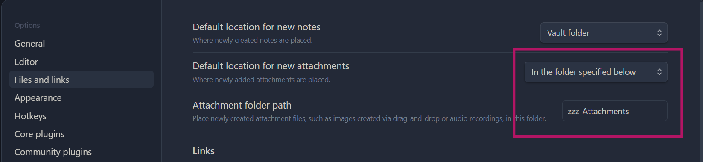

In this exercise you will create a **new Obsidian vault** (a notebook) and learn the basics: creating notes, writing in Markdown, and linking notes together.

You will write notes about your own work, so you can keep using this vault after the workshop.

## Part 1: Create your first Obsidian vault

- Open the Obsidian app
- Create a **new vault**
- Give it a name and browse a location (ideally somewhere that is backed up)
- Click **Create**

Your vault should open automatically.

::: {.callout-note collapse="true"}
## What if I already have an Obsidian vault?

If you already have a vault, you can use it or create a new one just for this workshop. Both work.
:::

## Part 2: Add your first note

- Create a new note named **Obsidian** (If you need help: <https://help.obsidian.md/create-note>)
- Copy the content below into the note (use the copy button in the top-right corner)
- Take a moment to look at the formatting (especially if you are new to Markdown)

```markdown
# Advantages

- **Free** for personal use
- All OS and mobile
- Simple *Markdown* format
- Notes are stored *locally* on my computer

# Best plugins

## Community plugins

1. Calendar
2. Tasks

## Core plugins

- Daily notes
- Templates

# To do

- [ ] Set up an attachments folder
- [ ] Try the command palette
```

## Part 3: Add notes about your own work

Now create **2–3 notes about your own work**. Some ideas:

- A **project** you are currently working on (what it is about, collaborators, next steps)
- A **paper** you are reading (main findings, what is relevant for you)
- A **method or tool** you use (how it works, useful links)

One of your notes should be about a project. You will need it again in [Exercise 3](exercise-3-tasks.qmd).

Add basic Markdown formatting like headings, bold text, lists. Your notes don't need to be perfect, just experiment with basic formatting.

::: {.callout-tip}
## Markdown reference

Use the Obsidian note as a reference, or check the "Basics" section of the [Markdown cheatsheet](markdown-cheatsheet.qmd).
:::

## Part 4: Link your notes

Link your notes to each other:

- In your project note, add a link to one of your other notes:
  - Type `[[` and select a note from the suggestions
- Click the link to make sure it works

::: {.callout-tip collapse="true"}
## How to find the square brackets `[ ]` on your keyboard

This depends on your keyboard layout. Common options:

- **US/UK keyboards:** keys right of **P**
- **Windows (many non‑US layouts):** **AltGr +** a number key (often 8 or 9)
- **Mac (many non‑US layouts):** **Option (⌥) +** a number key

If it still doesn't work, search online for: "square brackets" + your keyboard layout + Windows/Mac.
:::

### Try different ways of opening a note

- **Click:** open the note
- **Ctrl/Cmd + click:** open in a new tab
- **Ctrl/Cmd + hover:** open a preview (and you can edit from there)

Try each option once.

## Part 5: Set up an attachments folder

You can add attachments like images by:

- drag and drop
- copy/paste

Add an image or screenshot to one of your notes. Then look at the file explorer: by default, the image is saved in the main folder of your vault. With more attachments, this gets messy quickly.

To keep things tidy, create a dedicated folder and tell Obsidian to put new attachments there:

- Create a folder for attachments (e.g. `attachments` or `zzz_attachments` if you want it at the bottom of your folder list)
- Open **Settings** (gear icon bottom left) → **Files and links**
- Set **Default location for new attachments** to **In the folder specified below**
- Enter the attachment folder name (spelling must match exactly)

The setting should look like this:

{fig-alt="Obsidian settings under Files and links. Default location for new attachments is set to In the folder specified below, and the attachment folder path is zzz_Attachments."}

Now add a second image and check that it ends up in the attachments folder. You can also move the first image there. Obsidian updates the links automatically.

## Part 6: Use the command palette

The command palette lets you do everything in Obsidian from your keyboard.

- Open the command palette with **Ctrl/Cmd + P**
- Type "table" and select **Insert table** to add a table to one of your notes
- Look at what else you can do, e.g. type "PDF" to export a note as PDF

---

## Optional tasks (if you finish early)

You can do these in any order or skip them and take a break.

### Try more Markdown

- Experiment with additional formatting from the [Markdown cheatsheet](markdown-cheatsheet.qmd)
- For example:
  - Embed a note using an embedded link
  - Add external links to websites
- You can also check the [Advanced section](markdown-cheatsheet.qmd#advanced)

### Add tags and try search

- Add tags to your notes (e.g. tag all paper notes with `#paper`)
- Click a tag to open search and see all notes with that tag

### Change the editor theme

Obsidian comes with many different editor themes you can choose from. Change the theme like this:

- Open **Settings** (gear icon bottom left corner)
- Go to **Appearance**
- Under **Themes**, click **Manage**
- Browse and install a theme (you can always switch back)

### Create a Canvas

A Canvas is a digital whiteboard for brainstorming and getting an overview.

- Create a new Canvas (icon in the left ribbon or via the command palette)
- Add nodes, connect them, color and group them
- Drag and drop one of your notes onto the Canvas

---

Next: [Exercise 2: Daily notes](exercise-2-daily-notes.qmd) · Back to the [workshop page](../../21_obsidian-basics.qmd)
