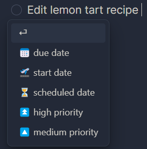

In this exercise, you will collect tasks from all over your vault in your daily notes using the **Tasks** plugin.

## Step 1: Install the Tasks plugin

1. Open **Settings** (gear icon bottom left)
2. Go to **Community plugins**
3. Click **Browse**
4. Search for **Tasks** (it should be on the very top of the list, created by Clare Macrae et al.)
5. **Install** and **Enable** the **Tasks** plugin

## Step 2: Add some tasks to your notes

Now add **2–3 example tasks** to your notes (not the daily notes, you can e.g. use one of your notes from [Exercise 1](exercise-1-basics.qmd)).

Any tasks are fine, you can just invent some.

Add **due dates** to the tasks (e.g. today or tomorrow).

::: {.callout-tip}
## Add due dates with "Tasks"

You should see a drop down menu after the task that lets you add a due date like in the image below.
You can add a due date by either of these methods:

- Select one of the suggested options
- Type a date
- Type a natural language date like "next sunday" and see if the plugin suggests the correct date

{width=200 fig-alt="Tasks plugin suggestion menu after a task, offering due date, start date, scheduled date and priority options."}
:::

## Step 3: Add the tasks query to your daily template

- Open your daily note template
- Find the section where your tasks should appear
- Add the following "Tasks" query block

````markdown
```tasks
due on {{date}}
```
````

`{{{date}}}` will be replaced automatically with the date of each daily note.

::: {.callout-tip collapse="true"}
## How to find the backtick `` ` `` on your keyboard

This depends on your keyboard layout. Common options:

- **US/UK keyboards:** key left of `1` (often shared with `~`)
- **Windows (many non-US layouts):** key near `Shift` or `Enter`, or **AltGr + key** (varies by layout)
- **Mac (many non-US layouts):** **Option (⌥) + key** (often the same key as `~`)

If it still doesn't work: Search online for: **"backtick key" + your keyboard layout + Windows/Mac**
:::

Test it:

- Check the due dates of your tasks again → Find a due date for which you don't have a daily note yet. If all tasks already have a daily note, just add a new task with a future due date
- Create the daily note for that due date

If all worked well, the task should now automatically appear in the newly created daily note.

::: {.callout-note collapse="true"}
## Help: My tasks do not appear

Check if

- the daily note was created after you added the query to the template. Older notes don't have the query.
- the due date of the task is the same as the date of the daily note
- the query says exactly `due on 2026-02-01` (with the date of the daily note). Click into the query block to see it.
:::

---

## Optional tasks (if you finish early)

### Modify the tasks query

The Tasks plugin allows you to change how tasks are displayed and filtered.

For these exercises:

- Modify the Tasks query in **one daily note** (not in the template)
- Observe what changes
- Keep what you like by adding it to your daily template

Pick one or two queries below that sound useful to you. You may need to create a few extra example tasks or adjust due dates.

#### Compact display mode

Add **short mode** to your Tasks query (replace the date with a date in your note):

````markdown
```tasks
due on 2026-02-01
short mode
```
````

#### List overdue tasks

List all tasks that are overdue:

````markdown
```tasks
due before 2026-02-01
```
````

#### Show all open tasks

````markdown
```tasks
not done
```
````

#### Filter tasks by folder

Show only tasks from a specific folder.
Replace `log` with a folder that is in your vault.

````markdown
```tasks
path includes log
```
````

#### Combine different queries

Try combining multiple options above.

Examples to try:

- Overdue tasks in short mode
- Tasks due today that are not done
- Tasks from a specific folder that are due today

### Update your template

If you found task queries that you like from the previous task, modify your daily template accordingly.
Then create a few notes to test it.

---

Back to the [workshop page](../../21_obsidian-basics.qmd)
