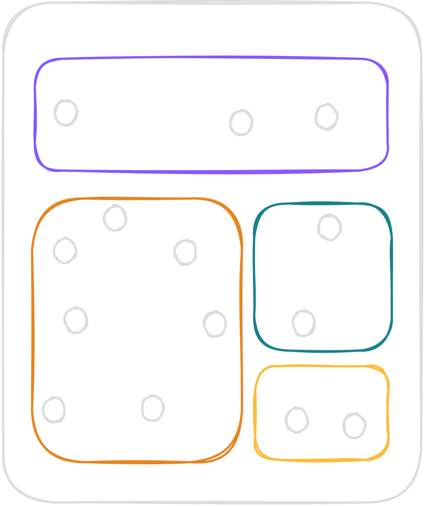
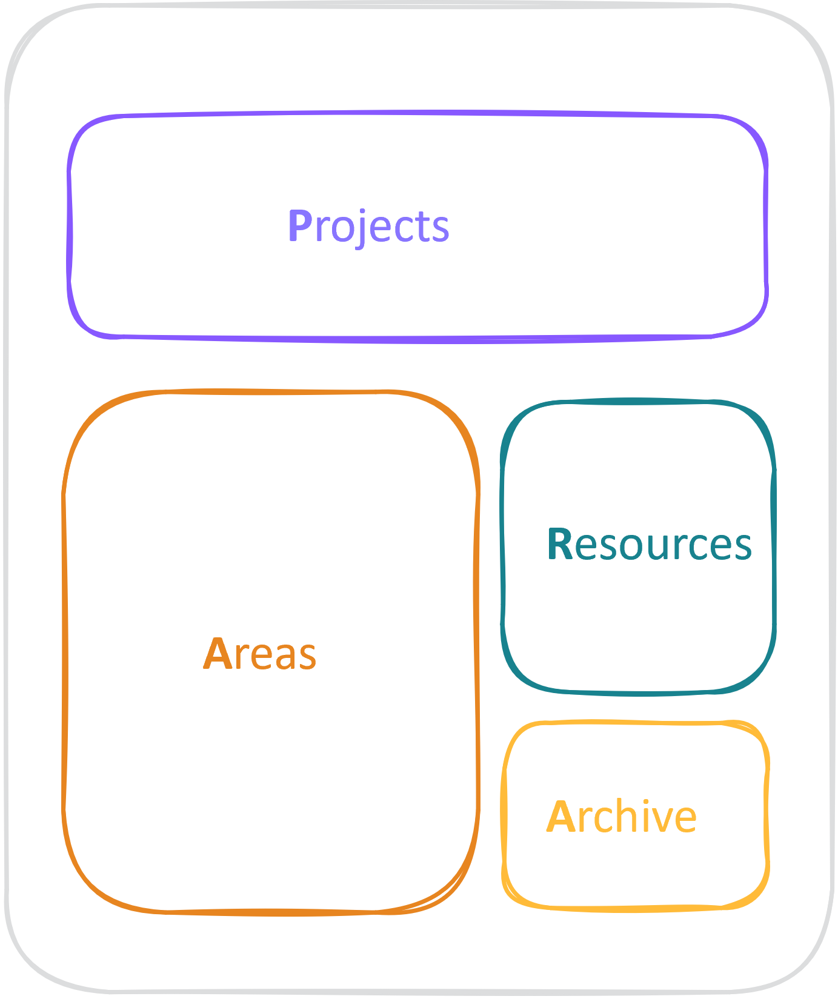
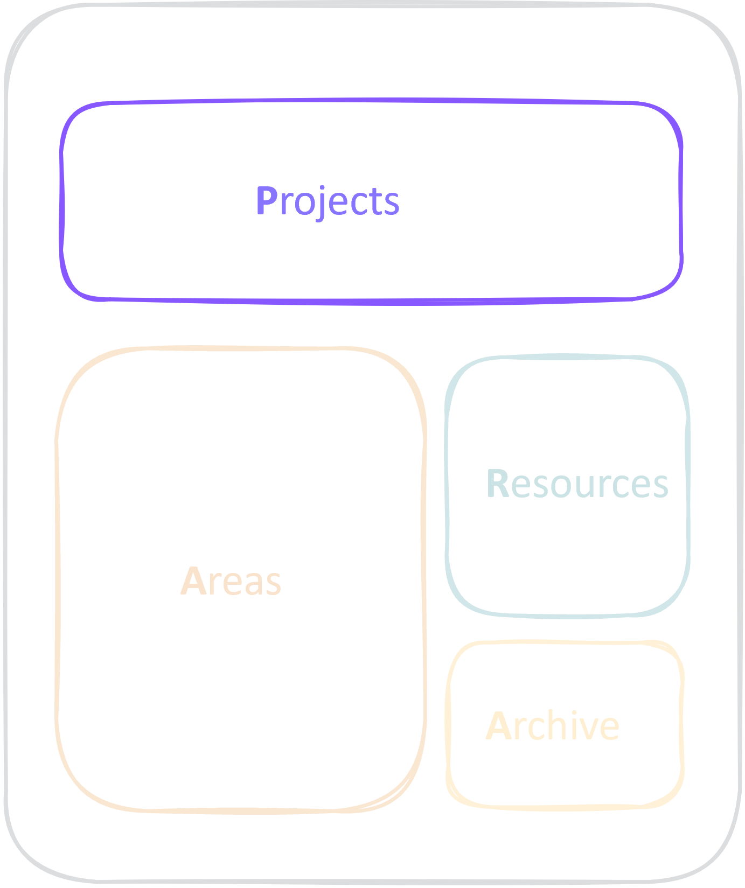
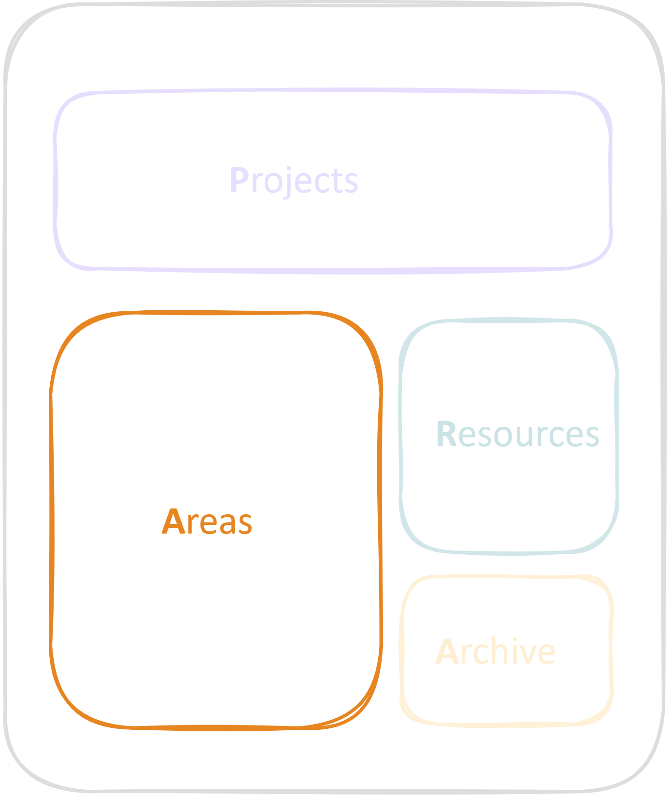
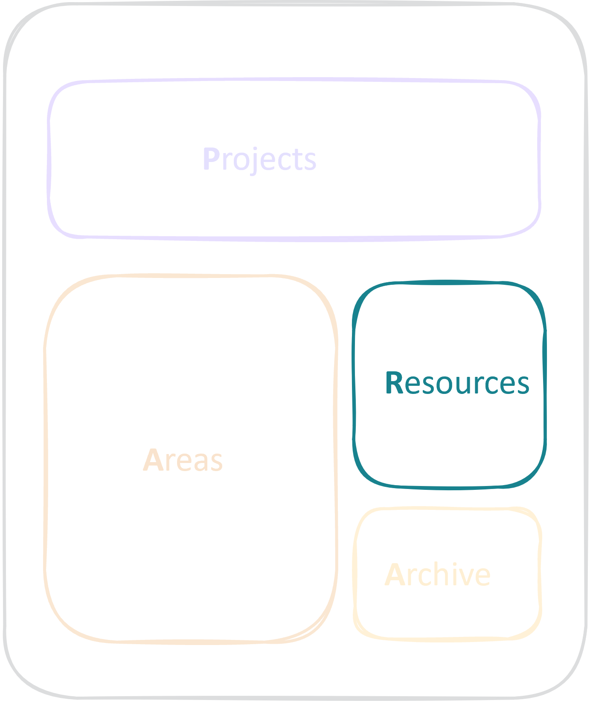
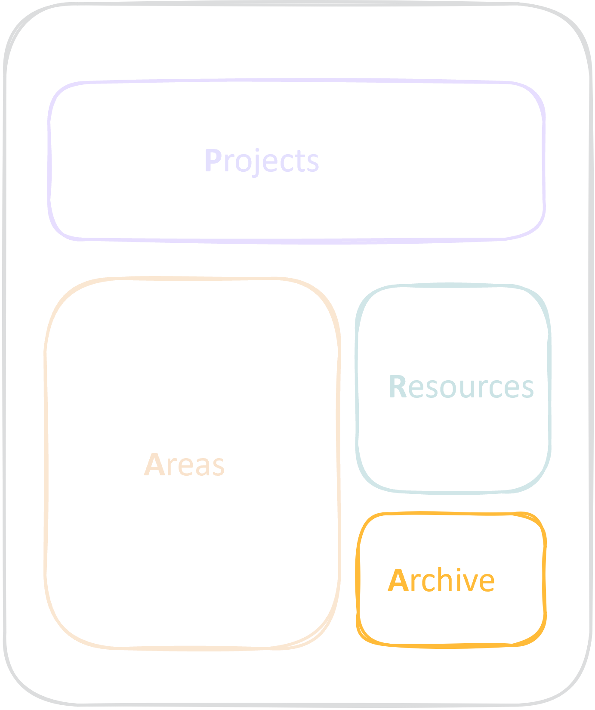

## What is this lecture series?

### Scientific workflows: Tools and Tips :hammer_and_wrench:

::: nonincremental

:date: Every 3rd Thursday :clock4: 4-5 p.m. :round_pushpin: Webex

- One topic from the world of scientific workflows
- Material provided [online](https://selinazitrone.github.io/tools_and_tips/)
- If you don't want to miss a lecture
  - [Subscribe to the mailing list](https://lists.fu-berlin.de/listinfo/toolsAndTips)
- For credit points: Send me a short message (Email or Webex)

:::

## Workshop goals

- Get started with *your own notebook*
- Set up a *daily notes* and *tasks* workflow
- Know if Obsidian is the *tool for you*

## Overview

:::{.nonincremental}
:::{.fragment}
1. **Introduction to Obsidian**
    - Basic functionality
    - Set up your own notebook
    - Organize your notes in folders
:::
:::{.fragment}
2. **Practical workflows** for PhD students
    - Plan your days with daily notes
    - Manage your tasks
    - What else you can do
:::
:::

## Organization

:::{.nonincremental}
- Live demo + Hands-on
- Questions anytime
:::

::: {.callout-note}
## Important links

Find all workshop material and links here: [workshop page](https://selinazitrone.github.io/tools_and_tips/sessions/21_obsidian-basics.html)
:::

## What makes notes useful?

- 🔎 **Searchable** → digital
- 📆 **Sustainable**
  - Can you understand them in years?
  - Does the software still exist?
- 🧱 **Open** and **simple formats**
- 🔗 **Connected**
- 😃 **Easy** and **enjoyable** to write

## Obsidian

- **Free** for personal use
- **All major OS** and mobile devices
- Notes are **simple Markdown** files
- Local first: Keeps your notes **private**
- Very **simple** at its core
- **Extend** and **customize** with plugins

# Obsidian basics {.inverse}

How to get started with your first notebook

## The two most important shortcuts

- `Ctrl/Cmd + O`: **Find or create** a note
  - Good to avoid duplicate notes
- `Ctrl/Cmd + P`: **Command palette**
  - Everything you can do in your vault, e.g. insert a table, export as PDF

## Your turn {.inverse}

> :pencil2: **Exercise 1 (15 min):**
>
> [Obsidian basics](https://selinazitrone.github.io/tools_and_tips/sessions/additional_material/21_obsidian-basics/exercise-1-basics.html)

::: nonincremental

- Stay in this meeting
- Questions: In the chat or just unmute yourself and share your screen if needed

:::

# Organize your notes {.inverse}

## Organize your notes in folders

::: {.columns}

::: {.column width="60%"}
- Goal: Easily **store** and **find** your notes again
- The crucial questions: Which folders/categories?

  ::: nonincremental
  - One option: the PARA system
  :::
:::

::: {.column width="40%"}
{width=85% fig-align="center" fig-alt="Sketch of a storage box divided into four differently colored drawers, each containing a few notes."}
:::

:::

## The PARA system

::: {.columns}

::: {.column width="60%"}
By [Tiago Forte](https://www.buildingasecondbrain.com/para): 4 core categories (= main folders) to sort your notes
:::

::: {.column width="40%"}
{width=85% fig-align="center" fig-alt="Sketch of a storage box with four drawers labelled Projects, Areas, Resources and Archive."}
:::

:::

## Projects

::: {.columns}

::: {.column width="60%"}
- Things you work on right now
- Things with a deadline
- Examples

  ::: nonincremental
  - Paper XYZ
  - Prepare workshop XYZ
  - Renovate my living room
  :::

- Subfolders for each project
:::

::: {.column width="40%"}
{width=85% fig-align="center" fig-alt="PARA sketch with the Projects drawer highlighted."}
:::

:::

## Areas

::: {.columns}

::: {.column width="60%"}
- Ongoing responsibilities without a concrete deadline
- Examples

  ::: nonincremental
  - PhD: bureaucratic things, overarching topics
  - Lab: notes on your research group
  - Finances
  :::
:::

::: {.column width="40%"}
{width=85% fig-align="center" fig-alt="PARA sketch with the Areas drawer highlighted."}
:::

:::

## Resources

::: {.columns}

::: {.column width="60%"}
- Reference and learning materials
- Topics you are interested in
- Useful for the future
- Examples

  ::: nonincremental
  - Literature notes
  - Tutorials
  - Documentation
  :::
:::

::: {.column width="40%"}
{width=85% fig-align="center" fig-alt="PARA sketch with the Resources drawer highlighted."}
:::

:::

## Archive

::: {.columns}

::: {.column width="60%"}
- Old, finished work and projects
:::

::: {.column width="40%"}
{width=85% fig-align="center" fig-alt="PARA sketch with the Archive drawer highlighted."}
:::

:::

# Daily notes {.inverse}

Plan your day and capture what comes up

## Your turn {.inverse}

> :pencil2: **Exercise 2 (15 min):**
>
> [Daily notes](https://selinazitrone.github.io/tools_and_tips/sessions/additional_material/21_obsidian-basics/exercise-2-daily-notes.html)

# Tasks {.inverse}

Collect tasks from your whole vault

## Your turn {.inverse}

> :pencil2: **Exercise 3 (10 min):**
>
> [The Tasks plugin](https://selinazitrone.github.io/tools_and_tips/sessions/additional_material/21_obsidian-basics/exercise-3-tasks.html)

## What else you can do

::: nonincremental

- **Zettelkasten**: Connect your ideas in small, linked notes
- **Literature notes** from Zotero
- **Project hubs** for tasks, meetings and notes
- ...

:::

## The demo vault

Examples, templates, and workflow guides from today and more:

::: nonincremental

- Daily notes and tasks
- Project hubs with tasks and meetings
- Zettelkasten
- Literature notes from Zotero
- Web clippings

:::

Download and instructions on the [workshop page](https://selinazitrone.github.io/tools_and_tips/sessions/21_obsidian-basics.html#demo-vault)

## Wrap-up

- Obsidian is not *one* system
  - Implement only what you find useful
- The most important: *actually writing notes*
- Start simple, add workflows later
- For more checkout the exercises, demo vault and resources on the [workshop page](https://selinazitrone.github.io/tools_and_tips/sessions/21_obsidian-basics.html)

## Next lecture/workshop

#### Topic: tba

 

:date: 26.11.2026 :clock4: 4-5 p.m. :round_pushpin: Webex

:bell: [Subscribe to the mailing list](https://lists.fu-berlin.de/listinfo/toolsAndTips)

:e-mail: For topic suggestions and/or feedback [send me an email](mailto:selina.baldauf@fu-berlin.de)

# The end :) {background-color="#2c2c2c"}

Questions?
