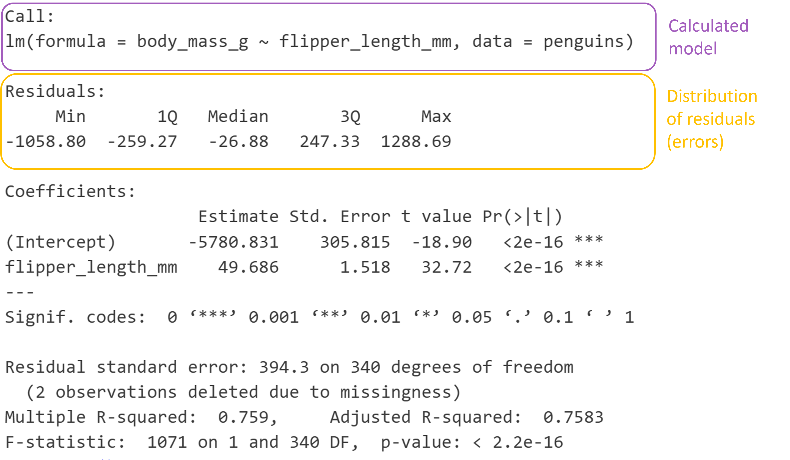
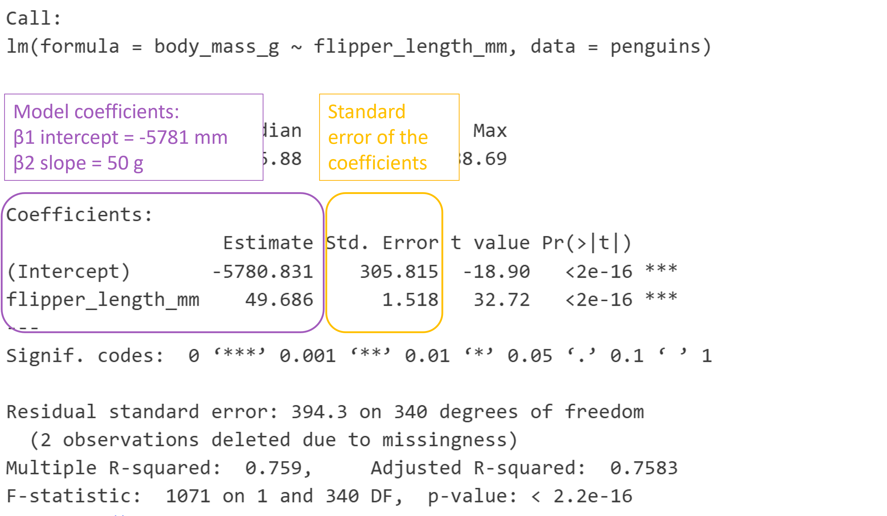

```{r}
#| label: setup
#| include: false
library(tidyverse)
library(broom)
library(palmerpenguins)
library(patchwork)
library(emmeans)

# same size for all figures (for a 50/50 column) and no white box around them
knitr::opts_chunk$set(
  fig.width = 6.4,
  fig.height = 5.4,
  dev.args = list(bg = "transparent")
)

theme_set(theme_minimal(base_size = 20))
theme_update(plot.background = element_blank())

# colors for model and error
col_model <- "#1F7A5C"
col_error <- "#C8553D"

# penguins without missing values, for the model plots
penguins_complete <- drop_na(penguins, body_mass_g, flipper_length_mm)
m_reg <- lm(body_mass_g ~ flipper_length_mm, data = penguins_complete)

# small white icons for the section slides
set.seed(1)
icon_reg <- tibble(x = runif(18, 0, 10), y = 1 + 0.5 * x + rnorm(18, sd = 0.7))
icon_anova <- tibble(
  group = rep(1:3, each = 6),
  x = group + runif(18, -0.15, 0.15),
  y = rep(c(3, 3.3, 5.5), each = 6) + rnorm(18, sd = 0.6)
)
icon_ancova <- tibble(
  group = rep(c("a", "b", "c"), each = 6),
  x = c(seq(1, 6, length.out = 6), seq(2, 7, length.out = 6), seq(5, 10, length.out = 6)),
  y = case_match(group, "a" ~ 1 + 0.5 * x, "b" ~ 0.4 + 0.5 * x, "c" ~ 1.6 + 0.7 * x) +
    rnorm(18, sd = 0.3)
)

section_icon <- function(type) {
  p <- switch(
    type,
    regression = ggplot(icon_reg, aes(x = x, y = y)) +
      geom_point(color = "white", size = 3) +
      geom_smooth(method = "lm", se = FALSE, color = "white", linewidth = 1.5),
    anova = ggplot(icon_anova, aes(x = x, y = y)) +
      geom_point(color = "white", size = 3, alpha = 0.6) +
      stat_summary(
        aes(x = group),
        fun = mean,
        geom = "point",
        color = "white",
        size = 6
      ) +
      expand_limits(x = c(0.4, 3.6)),
    ancova = ggplot(icon_ancova, aes(x = x, y = y, group = group)) +
      geom_point(color = "white", size = 3, alpha = 0.6) +
      geom_smooth(method = "lm", se = FALSE, color = "white", linewidth = 1.5)
  )
  p +
    theme_void() +
    theme(
      axis.line = element_line(color = "white", linewidth = 1),
      plot.margin = margin(10, 10, 10, 10)
    )
}
```

## What is this lecture series?

### Scientific workflows: Tools and Tips :hammer_and_wrench:

::: nonincremental

:date: Every 3rd Thursday :clock4: 4-5 p.m. :round_pushpin: Webex

- One topic from the world of scientific workflows
- Material provided [online](https://selinazitrone.github.io/tools_and_tips/)
- If you don't want to miss a lecture
  - [Subscribe to the mailing list](https://lists.fu-berlin.de/listinfo/toolsAndTips)
- For credit points: Send me a short message (Email or Webex)

:::

## Today: Linear models

#### How it works

:::{.nonincremental}

- There's a **GitHub repo** you download and open in your IDE
- I demonstrate each topic: **follow along in the scripts**
  - I will focus on explaining the statical code and concepts
  - I will assume you know R basics (data frames, pipes, ggplot2, ...)
- Each part has a short **exercise** to try it yourself
- **Questions** anytime: in the chat or just unmute

:::

## Get set up

:::{.nonincremental}

1. Click the green **Code** button → **Download ZIP**
2. Unzip it somewhere you can find it
3. Double-click the `.Rproj` file → opens in RStudio
   - *(Positron/VS code users: open the folder)*
4. Run `install_packages.R` to install today's packages (if you don't have them yet)

Repo: [https://github.com/selinaZitrone/lm-anova-workshop](https://github.com/selinaZitrone/lm-anova-workshop)

:::

# Statistical modelling {.inverse}

## An example

```{r}
#| label: simulate-bp
#| include: false
set.seed(12)
bp <- tibble(
  dose = round(runif(24, 0, 40)),
  reduction = round(2 + 0.4 * dose + rnorm(24, sd = 4), 1)
)
m_bp <- lm(reduction ~ dose, data = bp)

# predictions of three models: mean, line, curve
m_curve <- lm(reduction ~ I((dose - 8)^2), data = bp) # U-shape
bp <- bp |>
  mutate(
    mean = mean(reduction),
    line = fitted(m_bp),
    curve = fitted(m_curve)
  )

bp_labs <- labs(x = "Dose (mg)", y = "Reduction in\nblood pressure (mmHg)",
caption = "Simulated data")
```

```{r}
#| label: bp-data
#| fig-width: 8
#| fig-height: 4.6
ggplot(bp, aes(x = dose, y = reduction)) +
  geom_point(size = 3) +
  bp_labs
```


:::{.nonincremental}
- Patients take **different doses** of a medication
- We measure **how much their blood pressure drops**
:::

## Why do we model?

:::{.columns}

:::{.column .fragment width="32%"}

### Description

What is the **pattern** in our data?

::: {.text-small}
*How much more did blood pressure drop per mg in our patients?*
:::

:::

:::{.column width="2%"}
:::

:::{.column .fragment width="32%"}

### Inference

Is it **more than chance**, and how certain are we?

::: {.text-small}
*Does a higher dose lower blood pressure more in patients in general?*
:::

:::

:::{.column width="2%"}
:::

:::{.column .fragment width="32%"}

### Prediction

What do we **expect** for **new values**?

::: {.text-small}
*How much will blood pressure drop for a new patient with 25 mg?*
:::

:::

:::

## What is a model?

:::{.columns}

:::{.column width="50%"}

:::{.nonincremental}

**Data = [Model]{style="color:#1F7A5C"} + [Error]{style="color:#C8553D"}**

:::{.fragment fragment-index=1}
- [**Model**]{style="color:#1F7A5C"}: describes the main pattern in the data
:::

:::{.fragment fragment-index=2}
- [**Error**]{style="color:#C8553D"}: what the model doesn't explain
:::

:::

:::

:::{.column width="50%"}

:::{.r-stack}

:::{.fragment .fade-out fragment-index=1}

```{r}
#| label: bp-model-data
p_bp <- ggplot(bp, aes(x = dose, y = reduction)) +
  bp_labs

p_bp +
  geom_point(size = 3)
```

:::

:::{.fragment .fade-in-then-out fragment-index=1}

```{r}
#| label: bp-model-line
p_bp +
  geom_line(aes(y = line), color = col_model, linewidth = 1.5) +
  geom_point(size = 3)
```

:::

:::{.fragment fragment-index=2}

```{r}
#| label: bp-model-error
p_bp +
  geom_segment(aes(yend = line), color = col_error, linewidth = 1) +
  geom_line(aes(y = line), color = col_model, linewidth = 1.5) +
  geom_point(size = 3)
```

:::

:::

:::

:::

## Many models are possible

```{r}
#| label: bp-three-models
#| fig-width: 12
#| fig-height: 4.6
curve_grid <- tibble(dose = seq(min(bp$dose), max(bp$dose), length.out = 100))
curve_grid$curve <- predict(m_curve, newdata = curve_grid)

plot_bp_model <- function(model, title) {
  ggplot(bp, aes(x = dose, y = reduction)) +
    geom_segment(aes(yend = .data[[model]]), color = col_error) +
    geom_point(size = 2) +
    labs(x = "Dose (mg)", y = "Reduction (mmHg)", title = title) +
    theme_minimal(base_size = 17) +
    theme(
      plot.background = element_blank(),
      plot.title = element_text(face = "bold")
    )
}

p_mean <- plot_bp_model("mean", "The mean") +
  geom_line(aes(y = mean), color = col_model, linewidth = 1.5)
p_line <- plot_bp_model("line", "A line") +
  geom_line(aes(y = line), color = col_model, linewidth = 1.5)
p_curve <- plot_bp_model("curve", "A curve") +
  geom_line(data = curve_grid, aes(y = curve), color = col_model, linewidth = 1.5)

p_mean + p_line + p_curve
```

Which one do we choose?

- It depends on our **question** and what we **know** about the data
- As simple as possible, but it should describe the main pattern


# Linear models {.inverse}

## The `palmerpenguins` dataset

Data on 3 penguin species from Antarctica

```{r}
#| label: setup-penguins
#| echo: true
# install.packages("palmerpenguins")
library(palmerpenguins)
```

, artwork by Allison Horst](images/2026_12_17_linear-models-anova/lter_penguins.png){width="60%" fig-align="center" fig-alt="Drawing of a Chinstrap, a Gentoo and an Adelie penguin"}

## The `palmerpenguins` dataset

:::{.nonincremental}
- 344 penguins from **three species**
- Each row is **one penguin**
:::

```{r}
#| label: penguins-data
#| echo: true
penguins
```

## What we do today

```{r}
#| label: preview-setup
#| include: false
preview_theme <- theme_minimal(base_size = 13) +
  theme(
    plot.background = element_blank(),
    legend.position = "none"
  )

species_means <- summarise(
  penguins_complete,
  body_mass_g = mean(body_mass_g),
  .by = species
)
```

:::{.columns}

:::{.column width="50%"}

**Linear regression**

:::{.text-small}
*How much heavier are penguins with longer flippers?*<br>
[continuous predictor]{style="color:#7b8a8b"}
:::

:::

:::{.column width="50%"}

```{r}
#| label: preview-regression
#| fig-width: 4.4
#| fig-height: 2
ggplot(penguins_complete, aes(x = flipper_length_mm, y = body_mass_g)) +
  geom_point(alpha = 0.3, size = 1) +
  geom_smooth(method = "lm", se = FALSE, color = "black") +
  labs(x = "Flipper length (mm)", y = "Body mass (g)") +
  preview_theme
```

:::

:::

:::{.columns}

:::{.column width="50%"}

**ANOVA**

:::{.text-small}
*How much does body mass differ between species?*<br>
[categorical predictor]{style="color:#7b8a8b"}
:::

:::

:::{.column width="50%"}

```{r}
#| label: preview-anova
#| fig-width: 4.4
#| fig-height: 2
ggplot(penguins_complete, aes(x = species, y = body_mass_g, color = species)) +
  geom_jitter(width = 0.15, height = 0, alpha = 0.4, size = 1) +
  geom_point(data = species_means, color = "black", size = 3) +
  scale_color_viridis_d(end = 0.8) +
  labs(x = "Species", y = "Body mass (g)") +
  preview_theme
```

:::

:::

:::{.columns}

:::{.column width="50%"}

**ANCOVA**

:::{.text-small}
*Does the relationship differ between species?*<br>
[continuous and categorical predictor]{style="color:#7b8a8b"}
:::

:::

:::{.column width="50%"}

```{r}
#| label: preview-ancova
#| fig-width: 4.4
#| fig-height: 2
ggplot(
  penguins_complete,
  aes(x = flipper_length_mm, y = body_mass_g, color = species)
) +
  geom_point(alpha = 0.3, size = 1) +
  geom_smooth(method = "lm", se = FALSE) +
  scale_color_viridis_d(end = 0.8) +
  labs(x = "Flipper length (mm)", y = "Body mass (g)") +
  preview_theme
```

:::

:::

# Linear regression {.inverse}

> continuous predictor

:::{.absolute bottom="-300" right="0"}

```{r}
#| label: icon-regression
#| fig-width: 3
#| fig-height: 2.2
section_icon("regression")
```

:::

## How much heavier are penguins with longer flippers?

:::{.columns}

:::{.column width="50%"}

- **Expectation:** Penguins with longer flippers are heavier
- **Question:** By how much, and how certain are we?

:::

:::{.column width="50%"}

```{r}
#| label: reg-data
peng_labs <- labs(x = "Flipper length (mm)", y = "Body mass (g)")
peng_coord <- coord_cartesian(xlim = c(170, 233), ylim = c(2600, 6400))

ggplot(penguins_complete, aes(x = flipper_length_mm, y = body_mass_g)) +
  geom_point(alpha = 0.4) +
  peng_labs +
  peng_coord
```

:::

:::

## The model

:::{.columns}

:::{.column width="50%"}

:::{.nonincremental}

**Data = [Model]{style="color:#1F7A5C"} + [Error]{style="color:#C8553D"}**

:::{.fragment fragment-index=1}
y = [β~0~ + β~1~ · x]{style="color:#1F7A5C"} + [ε]{style="color:#C8553D"}
:::

:::{.fragment fragment-index=2}
body mass = [β~0~ + β~1~ · flipper length]{style="color:#1F7A5C"} + [ε]{style="color:#C8553D"}
:::

:::{.fragment .text-small fragment-index=3}
- [**β~0~**]{style="color:#1F7A5C"}: intercept, body mass at a flipper length of 0
- [**β~1~**]{style="color:#1F7A5C"}: slope, change in body mass per mm
:::

:::{.fragment .text-small fragment-index=4}
- [**ε**]{style="color:#C8553D"}: error, what the model doesn't explain
:::

:::

:::

:::{.column width="50%"}

:::{.r-stack}

```{r}
#| label: model-data
ggplot(penguins_complete, aes(x = flipper_length_mm, y = body_mass_g)) +
  geom_point(alpha = 0.3) +
  peng_labs +
  peng_coord
```

:::{.fragment fragment-index=1}

```{r}
#| label: model-line
# the same plot with invisible axes, to add one layer per click
pred <- augment(m_reg, data = penguins_complete)

p_layer <- ggplot(pred, aes(x = flipper_length_mm, y = body_mass_g)) +
  peng_labs +
  peng_coord +
  theme(
    axis.text = element_text(color = "transparent"),
    axis.title = element_text(color = "transparent"),
    panel.grid = element_blank()
  )

p_layer +
  geom_line(aes(y = .fitted), color = col_model, linewidth = 1.8)
```

:::

:::{.fragment fragment-index=3}

```{r}
#| label: model-slope
slope_x <- c(185, 205)
slope_y <- predict(m_reg, tibble(flipper_length_mm = slope_x))

# stored as a list to reuse it on the terminology slide
slope_layers <- list(
  annotate(
    "segment",
    x = c(slope_x[1], slope_x[2]),
    xend = c(slope_x[2], slope_x[2]),
    y = c(slope_y[1], slope_y[1]),
    yend = c(slope_y[1], slope_y[2]),
    color = col_model,
    linewidth = 1.2,
    linetype = "dashed"
  ),
  annotate(
    "text",
    x = slope_x[2] + 1,
    y = mean(slope_y) - 250,
    label = "slope~beta[1]",
    parse = TRUE,
    color = col_model,
    size = 8,
    hjust = 0
  ),
  # the intercept is far below the plot
  annotate(
    "segment",
    x = 196,
    xend = 171,
    y = 2780,
    yend = 2640,
    color = col_model,
    linewidth = 1,
    arrow = arrow(length = unit(0.3, "cm"))
  ),
  annotate(
    "text",
    x = 197,
    y = 2780,
    label = paste0("beta[0]~'= ", round(coef(m_reg)[[1]]), " g at 0 mm'"),
    parse = TRUE,
    color = col_model,
    size = 6,
    hjust = 0
  )
)

p_layer + slope_layers
```

:::

:::{.fragment fragment-index=4}

```{r}
#| label: model-error
# one penguin to show the error
one_penguin <- slice_max(
  filter(pred, flipper_length_mm == 221),
  body_mass_g,
  n = 1
)

error_layers <- list(
  geom_segment(
    data = one_penguin,
    aes(yend = .fitted),
    color = col_error,
    linewidth = 1.4
  ),
  geom_point(data = one_penguin, color = col_error, size = 4),
  annotate(
    "text",
    x = 219,
    y = 6200,
    label = "epsilon",
    parse = TRUE,
    color = col_error,
    size = 9,
    hjust = 1
  )
)

p_layer + error_layers
```

:::

:::

:::

:::

## Terminology {visibility="hidden"}

:::{.columns}

:::{.column width="50%"}

y = [β~0~ + β~1~ · x]{style="color:#1F7A5C"} + [ε]{style="color:#C8553D"}<br>
ŷ = [β~0~ + β~1~ · x]{style="color:#1F7A5C"}

:::{.text-small}

| Term | | In our example |
|:-----|:-|:---------------|
| Response | y | body mass |
| Predictor | x | flipper length |
| Parameters | β~0~, β~1~ | intercept, slope |
| Fitted value | ŷ | value on the line |
| Residual | y − ŷ | observed − fitted |

: {tbl-colwidths="[36,20,44]"}

:::

:::{.fragment .text-small}
The residuals are our estimate of the error ε
:::

:::

:::{.column width="50%"}

```{r}
#| label: terminology
# the full figure from the model slide, plus fitted value and residual
ggplot(pred, aes(x = flipper_length_mm, y = body_mass_g)) +
  geom_point(alpha = 0.3) +
  geom_line(aes(y = .fitted), color = col_model, linewidth = 1.8) +
  slope_layers +
  error_layers +
  geom_point(data = one_penguin, aes(y = .fitted), color = col_model, size = 4) +
  annotate(
    "label",
    x = c(219, 223),
    y = c(mean(c(one_penguin$body_mass_g, one_penguin$.fitted)), one_penguin$.fitted),
    label = c("residual", "fitted~hat(y)"),
    parse = TRUE,
    color = c(col_error, col_model),
    hjust = c(1, 0),
    size = 6,
    fill = "#F1F1F1",
    linewidth = 0
  ) +
  peng_labs +
  peng_coord
```

:::

:::

## Which model is best?

:::{.columns}

:::{.column width="50%"}

Many lines are possible

. . .

So how do we find the best one?

:::

:::{.column width="50%"}

```{r}
#| label: candidate-lines
# many random lines around the center of the data
center <- summarise(
  penguins_complete,
  x = mean(flipper_length_mm),
  y = mean(body_mass_g)
)

set.seed(5)
many_lines <- tibble(
  slope = runif(40, 10, 90),
  intercept = center$y + rnorm(40, sd = 250) - slope * center$x
)

ggplot(penguins_complete, aes(x = flipper_length_mm, y = body_mass_g)) +
  geom_point(alpha = 0.3) +
  geom_abline(
    data = many_lines,
    aes(slope = slope, intercept = intercept),
    color = col_model,
    linewidth = 0.4,
    alpha = 0.7
  ) +
  peng_labs +
  peng_coord
```

:::

:::

## The best line has the smallest residuals

:::{.columns}

:::{.column width="50%"}

:::{.nonincremental}

**Model residuals**

$Y_i - \hat{Y}_i$

:::{.fragment fragment-index=1}
**Residual sum of squares (RSS)**

$RSS = \sum_{i=1}^{n} (Y_i - \hat{Y}_i)^2$
:::

:::{.fragment fragment-index=2}
**Aim of model fitting:**<br>
Find model coefficients that lead to the lowest RSS<br>
[(ordinary least squares, OLS)]{.text-small}
:::

:::

:::

:::{.column width="50%"}

:::{.r-stack}

```{r}
#| label: residual-one
# one penguin with observed and fitted value
ggplot(pred, aes(x = flipper_length_mm, y = body_mass_g)) +
  geom_point(alpha = 0.3) +
  geom_line(aes(y = .fitted), color = col_model, linewidth = 1.8) +
  geom_segment(
    data = one_penguin,
    aes(yend = .fitted),
    color = col_error,
    linewidth = 1.4
  ) +
  geom_point(data = one_penguin, color = col_error, size = 4) +
  geom_point(data = one_penguin, aes(y = .fitted), color = col_model, size = 4) +
  annotate(
    "label",
    x = c(219, 223),
    y = c(one_penguin$body_mass_g, one_penguin$.fitted),
    label = c("y[i]", "hat(y)[i]"),
    parse = TRUE,
    color = c(col_error, col_model),
    hjust = c(1, 0),
    size = 8,
    fill = "#F1F1F1",
    linewidth = 0
  ) +
  peng_labs +
  peng_coord
```

:::{.fragment fragment-index=1}

```{r}
#| label: residual-all
# all residuals, with the line drawn again on top
p_layer +
  geom_segment(aes(yend = .fitted), color = col_error, alpha = 0.5) +
  geom_line(aes(y = .fitted), color = col_model, linewidth = 1.8)
```

:::

:::

:::

:::

## When can we trust the results?

:::{.columns}

:::{.column width="50%"}

The model makes **assumptions**:

:::{.text-small}
- The relationship is **linear**
- Residuals are **normally distributed** around the line
- Residual **variance is constant** along the line
- No strong **outliers**
- Observations are **independent** (study design!)
:::

:::

:::{.column width="50%"}

```{r}
#| label: assumptions
# normal distributions around the line at three flipper lengths,
# drawn on both sides so that the widest part sits on the line
sigma_reg <- sigma(m_reg)

z <- seq(-2.5, 2.5, length.out = 100)
curves <- tibble(x0 = c(185, 205, 225)) |>
  mutate(fitted = predict(m_reg, tibble(flipper_length_mm = x0))) |>
  reframe(
    y = fitted + c(z, rev(z)) * sigma_reg,
    x = x0 + c(1, -1)[rep(1:2, each = 100)] * 4 * dnorm(c(z, rev(z))) / dnorm(0),
    .by = c(x0, fitted)
  )

ggplot(pred, aes(x = flipper_length_mm, y = body_mass_g)) +
  geom_point(alpha = 0.2) +
  geom_polygon(
    data = curves,
    aes(x = x, y = y, group = x0),
    color = col_error,
    fill = col_error,
    alpha = 0.15,
    linewidth = 1
  ) +
  geom_line(aes(y = .fitted), color = col_model, linewidth = 1.5) +
  geom_segment(
    data = distinct(curves, x0, fitted),
    aes(x = x0, xend = x0, y = fitted - 2.5 * sigma_reg, yend = fitted + 2.5 * sigma_reg),
    color = col_error,
    linetype = "dotted"
  ) +
  peng_labs +
  coord_cartesian(xlim = c(170, 233), ylim = c(2200, 6800))
```

:::

:::

## Linear regression in R

:::{.columns}

:::{.column width="50%"}

:::{.nonincremental}

Fit a linear model with `lm()`:

<pre><code>lm(
  formula = <span style="color:#2E6F9E;font-weight:bold">response</span> ~ <span style="color:#B8860B;font-weight:bold">predictor</span>,
  data = <span style="color:#7b8a8b;font-weight:bold">data</span>
)</code></pre>

:::

:::{.fragment}

<br>

For our penguins:

```{r}
#| label: lm-penguins
#| echo: true
m_reg <- lm(
  body_mass_g ~ flipper_length_mm, 
  data = penguins
  )
```

:::

:::

:::{.column width="50%"}

```{r}
#| label: lm-syntax
ggplot(penguins_complete, aes(x = flipper_length_mm, y = body_mass_g)) +
  geom_point(alpha = 0.3) +
  geom_smooth(method = "lm", se = FALSE, color = col_model, linewidth = 1.5) +
  labs(x = "flipper_length_mm", y = "body_mass_g") +
  theme(
    axis.title.y = element_text(color = "#2E6F9E", face = "bold"),
    axis.title.x = element_text(color = "#B8860B", face = "bold")
  )
```

:::

:::

## Check the model assumptions

```{r}
#| label: check-model
#| echo: true
#| fig-width: 10
#| fig-height: 7.5
#| output-location: slide
performance::check_model(m_reg)
```

## Check the model assumptions

Look for **clear patterns**, not perfection

```{r}
#| label: residual-examples
#| fig-width: 12
#| fig-height: 3.6
# simulated residuals: one good case and three problems
set.seed(3)
n <- 150
x_fitted <- runif(n)

resid_examples <- tibble(
  problem = rep(c("Looks good", "Not linear", "Spread not constant"), each = n),
  fitted = rep(x_fitted, 3),
  residual = c(
    rnorm(n, sd = 0.2),
    3 * (x_fitted - 0.5)^2 - 0.25 + rnorm(n, sd = 0.1),
    rnorm(n, sd = 0.05 + 0.4 * x_fitted)
  )
)

p_resid <- ggplot(resid_examples, aes(x = fitted, y = residual)) +
  geom_hline(yintercept = 0, linetype = "dashed") +
  geom_point(alpha = 0.5) +
  facet_wrap(~problem) +
  labs(x = "Fitted values", y = "Residuals")

p_qq <- tibble(problem = "Not normal", residual = rexp(n) - 1) |>
  ggplot(aes(sample = residual)) +
  stat_qq_line(linetype = "dashed") +
  stat_qq(alpha = 0.5) +
  facet_wrap(~problem) +
  labs(x = "Theoretical quantiles", y = "Sample quantiles")

p_good <- p_resid %+% filter(resid_examples, problem == "Looks good")
p_curve <- p_resid %+% filter(resid_examples, problem == "Not linear")
p_spread <- p_resid %+% filter(resid_examples, problem == "Spread not constant")

wrap_plots(p_good, p_curve, p_spread, p_qq, nrow = 1) &
  theme(
    axis.text = element_blank(),
    text = element_text(size = 16),
    strip.text = element_text(size = 18, face = "bold")
  )
```


## How big is the effect?

```{r}
#| label: summary
#| echo: true
summary(m_reg)
```

## Summary table

{fig-alt="Top part of the summary table, showing the model formula, residuals "}

## Summary table: coefficients and effect size

{fig-alt="Middle part of the summary table, showing the coefficients, their standard errors, t-values and p-values"}

- Per mm of flipper length, penguins are on average **49.7 g heavier**

## How precise is the estimate?

:::{.columns}

:::{.column width="50%"}

```{r}
#| label: confint
#| echo: true
confint(m_reg)
```
- Other samples would give slightly different slopes 
- The **95% confidence interval (CI)** shows range of plausible values
- Slope: **46.7 to 52.7 g** per mm
- Intercept: not interesting here

:::

:::{.column width="50%"}

```{r}
#| label: confint-band
ggplot(penguins_complete, aes(x = flipper_length_mm, y = body_mass_g)) +
  geom_point(alpha = 0.3) +
  geom_smooth(method = "lm", color = col_model, fill = col_model, alpha = 0.6) +
  peng_labs +
  peng_coord
```

:::

:::

## How much evidence is there for an effect?

Is the effect we observe real or could it be due to chance?

. . .

Compare the **null model** (mean) with our **model** (line):

```{r}
#| label: null-vs-line
#| fig-width: 12
#| fig-height: 3.8
# the null model (mean) and our model (line) with their residuals
null_vs_line <- bind_rows(
  mutate(pred, model = "Null model: the mean", fitted = mean(body_mass_g)),
  mutate(pred, model = "Our model: the line", fitted = .fitted)
)

ggplot(null_vs_line, aes(x = flipper_length_mm, y = body_mass_g)) +
  geom_segment(aes(yend = fitted), color = col_error, alpha = 0.5) +
  geom_point(alpha = 0.3) +
  geom_line(aes(y = fitted), color = col_model, linewidth = 1.5) +
  facet_wrap(~model) +
  peng_labs +
  peng_coord
```

## How much evidence is there for an effect?

```{r}
#| label: anova
#| echo: true
car::Anova(m_reg)
```

- `flipper_length_mm`: how much the regression reduces the RSS compared to the mean
  - if p < 0.05, the effect is significant
- `Residuals`: what's left over, the RSS of our model

. . .

Result: Strong evidence of an effect (F = 1071, p < 0.001).

## How much variance does the model explain?

Get the R-squared values from the summary table (bottom)

{fig-alt="Bottom part of the summary table, showing the R-squared and adjusted R-squared values"}

- R² = 1 − RSS(model) / RSS(null model)
  - share of variation explained by the model (0 = no better than mean, 1 = perfect fit)
- Adjusted R²: corrected for the number of predictors. Use it to compare models.

. . .

Result: Flipper length explains 76% of the variation in body mass (R² = 0.76).

## Show the model

```{r}
#| label: plot-model
#| echo: true
#| output-location: column
ggplot(
  penguins,
  aes(x = flipper_length_mm, y = body_mass_g)
) +
  geom_point() +
  geom_smooth(method = "lm")
```

- `geom_smooth(method = "lm")` fits the same model and shows the 95% CI of the line

## Plot the model with `augment()`

`broom::augment()` adds fitted values and confidence intervals to the data:

```{r}
#| label: augment
#| echo: true
# step 1: add fitted values and confidence intervals to the data
pred <- augment(m_reg, interval = "confidence")
pred
```

- `.fitted`: fitted values (on the line)
- `.lower` and `.upper`: 95% CI of the fitted values

## Plot the model with `augment()`

```{r}
#| label: plot-augment
#| echo: true
#| output-location: column

# step 2: plot the data, fitted values and CI
ggplot(
  pred,
  aes(x = flipper_length_mm, y = body_mass_g)
) +
  geom_point() +
  geom_ribbon(
    aes(ymin = .lower, ymax = .upper),
    alpha = 0.3
  ) +
  geom_line(aes(y = .fitted))
```

- Advantage: Always plot your model, even if `geom_smooth()` does not work

## Predict new values with `augment()`

```{r}
#| label: predict
#| echo: true
# Create a new data frame with the values you want to predict
new_data <- tibble(flipper_length_mm = 200)
# predict using the model (convidence interval)
augment(m_reg, newdata = new_data, interval = "confidence")
# predict using the model (prediction interval)
augment(m_reg, newdata = new_data, interval = "prediction")
```

- **Confidence interval**: mean of all penguins with 200 mm flippers
- **Prediction interval**: body mass of one new penguin. Wider, because it includes individual variation between penguins
- Note: Only predict within the range of the data (172–231 mm)

## Report the results

:::{.columns}

:::{.column width="50%"}

A result in a paper could look like this:

> Body mass increased by **49.7 g per mm** of flipper length (95% CI 46.7–52.7; F~1,340~ = 1070.7, p < 0.001, R² = 0.76).

:::

:::{.column width="50%"}

```{r}
#| label: plot-augment2

ggplot(
  pred,
  aes(x = flipper_length_mm, y = body_mass_g)
) +
  geom_point() +
geom_smooth(method = "lm")
```

:::

:::

. . .

Always report the **size** of the effect and its **uncertainty**, not only the p-value

## Linear model step by step

:::{.text-small}

| Step | Linear regression |
|:-----|:------------------|
| **Question** | How much heavier are penguins with longer flippers? |
| **Fit model** | `lm(body_mass_g ~ flipper_length_mm, data = penguins)` |
| **Check assumptions** | `performance::check_model()` |
| **Answer** | Effect size? `summary()`; How precise? `confint()`; How much evidence? `car::Anova()`; How much variation? `summary()` R² |
| **Show** | `geom_smooth(method = "lm")` or `augment()` |
| **Report** | Effect, 95% CI, F, p, R² |

:::

## Your turn {.inverse}

> :pencil2: **Exercise 1 (~10 min):**
>
> Open `exercises/01_regression_exercise.R`

# ANOVA {.inverse}

> categorical predictor

:::{.absolute bottom="-300" right="0"}

```{r}
#| label: icon-anova
#| fig-width: 3
#| fig-height: 2.2
section_icon("anova")
```

:::

## How much does body mass differ between species?

:::{.columns}

:::{.column width="50%"}

- **Expectation:** Gentoo penguins are heavier
- **Question:** Which species differ, and by how much?

:::

:::{.column width="50%"}

```{r}
#| label: anova-data
ggplot(penguins_complete, aes(x = species, y = body_mass_g, color = species)) +
  geom_jitter(width = 0.15, height = 0, alpha = 0.4) +
  scale_color_viridis_d(end = 0.8) +
  labs(x = "Species", y = "Body mass (g)") +
  theme(legend.position = "none")
```

:::

:::

## The model

:::{.columns}

:::{.column width="50%"}

:::{.nonincremental}

**Data = [Model]{style="color:#1F7A5C"} + [Error]{style="color:#C8553D"}**

:::{.fragment fragment-index=1}
body mass = [β~0~ + β~1~ · Chinstrap + β~2~ · Gentoo]{style="color:#1F7A5C"} + [ε]{style="color:#C8553D"}
:::

:::{.fragment .text-small fragment-index=2}
Chinstrap = 1 for Chinstrap penguins, 0 for all others (same for Gentoo)
:::

:::{.fragment .text-small fragment-index=3}
- [**β~0~**]{style="color:#1F7A5C"}: mean of Adelie, the **reference** group
:::

:::{.fragment .text-small fragment-index=4}
- [**β~1~, β~2~**]{style="color:#1F7A5C"}: differences to Adelie
:::

:::

:::

:::{.column width="50%"}

```{r}
#| label: anova-model-setup
#| include: false
m_anova <- lm(body_mass_g ~ species, data = penguins_complete)
b_anova <- coef(m_anova)

# species means and an empty plot with invisible axes, to add one layer per click
species_means <- summarise(
  penguins_complete,
  body_mass_g = mean(body_mass_g),
  .by = species
)

p_anova <- ggplot(penguins_complete, aes(x = species, y = body_mass_g)) +
  labs(x = "Species", y = "Body mass (g)") +
  coord_cartesian(ylim = c(2600, 6400))

p_anova_layer <- p_anova +
  geom_blank() +
  theme(
    axis.text = element_text(color = "transparent"),
    axis.title = element_text(color = "transparent"),
    panel.grid = element_blank()
  )
```

:::{.r-stack}

```{r}
#| label: anova-model-data
p_anova +
  geom_jitter(
    aes(color = species),
    position = position_jitter(width = 0.15, height = 0, seed = 1),
    alpha = 0.4
  ) +
  geom_point(data = species_means, size = 4) +
  scale_color_viridis_d(end = 0.8) +
  theme(legend.position = "none")
```

:::{.fragment fragment-index=3}

```{r}
#| label: anova-model-b0
p_anova_layer +
  geom_hline(yintercept = b_anova[[1]], color = col_model, linewidth = 1.2, linetype = "dashed") +
  annotate(
    "text",
    x = 0.6,
    y = b_anova[[1]] - 250,
    label = "beta[0]",
    parse = TRUE,
    color = col_model,
    size = 8
  )
```

:::

:::{.fragment fragment-index=4}

```{r}
#| label: anova-model-b1-b2
p_anova_layer +
  annotate(
    "segment",
    x = 2.75,
    xend = 2.75,
    y = b_anova[[1]],
    yend = b_anova[[1]] + b_anova[[3]],
    color = col_model,
    linewidth = 1.2,
    arrow = arrow(length = unit(0.3, "cm"))
  ) +
  annotate(
    "text",
    x = c(2.2, 2.7),
    y = c(b_anova[[1]] - 300, b_anova[[1]] + b_anova[[3]] + 300),
    label = c("beta[1]", "beta[2]"),
    parse = TRUE,
    color = col_model,
    size = 8,
    hjust = c(0, 1)
  )
```

:::

:::

:::

:::

## Fit the model

```{r}
#| label: anova-fit
#| echo: true
m_anova <- lm(body_mass_g ~ species, data = penguins)
```

## Check model assumptions

```{r}
#| label: anova-check
#| echo: true
#| fig-width: 10
#| fig-height: 7.5
#| output-location: slide
performance::check_model(m_anova)
```

## How big are the differences?

```{r}
#| label: anova-summary
#| echo: true
summary(m_anova)
```

:::{.text-small}
- `(Intercept)`: mean of Adelie, the reference (3701 g)
- `speciesChinstrap`, `speciesGentoo`: differences to Adelie (+32 g, +1375 g)
:::

## How much evidence is there for an effect?

```{r}
#| label: anova-anova
#| echo: true
car::Anova(m_anova)
```

- `species`: does species matter **as a whole** factor?
- `Residuals`: error that's left after accounting for the effect of species

. . .

Result: Strong evidence that body mass differs between species (F~2,339~ = 343.6, p < 0.001).

## Mean body mass per species

```{r}
#| label: anova-emmeans
#| echo: true
library(emmeans)
# mean estimate separately for each species
emm <- emmeans(m_anova, ~species)
emm
```

- `emmeans()` (package `emmeans`): mean and 95% CI for each group, from the model

## Which species differ?

Use the `pairs()` function to compare all species pairs.

```{r}
#| label: anova-pairs
#| echo: true
pairs(emm, reverse = TRUE, infer = TRUE)
```

- One row per pair: difference (how big?), CI (how precise?), p-value (how much evidence?)
- P-values and CIs are **Tukey-adjusted** for multiple comparisons

## Show the model

Use the results from `emmeans()` to show the means and 95% CI of the means on top of the data.

```{r}
#| label: anova-plot
#| echo: true
#| output-location: column
ggplot(penguins, aes(x = species, y = body_mass_g)) +
  geom_jitter(
    aes(color = species),
    width = 0.15,
    height = 0,
    alpha = 0.4
  ) +
  geom_pointrange(
    data = as_tibble(emm),
    aes(y = emmean, ymin = lower.CL, ymax = upper.CL),
    size = 0.7,
    linewidth = 1
  ) +
  scale_color_viridis_d(end = 0.8) +
  labs(x = "Species", y = "Body mass (g)") +
  theme(legend.position = "none")
```

## Report the results

> Body mass differed between species (F~2,339~ = 343.6, p < 0.001). Gentoo were heavier than Adelie (1375 g, 95% CI 1243–1508, p < 0.001) and Chinstrap (1343 g, 95% CI 1178–1507, p < 0.001), whereas we found no evidence of a difference between Chinstrap and Adelie (32 g, 95% CI −127 to 191, p = 0.88).

## Linear model step by step

:::{.text-small}

| Step | Linear regression | ANOVA |
|:-----|:------------------|:------|
| **Question** | How much heavier are penguins with longer flippers? | How much does body mass differ between species? |
| **Fit model** | `lm(body_mass_g ~ flipper_length_mm)` | `lm(body_mass_g ~ species)` |
| **Check assumptions** | `performance::check_model()` | `performance::check_model()` |
| **Answer** | `summary()`, `confint()`, `car::Anova()` | `car::Anova()`, [`emmeans()`, `pairs()`]{.highlight-ylw} |
| **Show** | `geom_smooth(method = "lm")` or `augment()` | Data + means and 95% CI from `emmeans()` |
| **Report** | Effect, 95% CI, F, p, R² | F, p, and each difference with 95% CI and p |

:::

## Your turn {.inverse}

> :pencil2: **Exercise 2 (~10 min):**
>
> Open `exercises/02_anova_exercise.R`

# ANCOVA {.inverse}

> continuous and categorical predictor

:::{.absolute bottom="-300" right="0"}

```{r}
#| label: icon-ancova
#| fig-width: 3
#| fig-height: 2.2
section_icon("ancova")
```

:::

## Does the relationship differ between species?

:::{.columns}

:::{.column width="50%"}

- **Expectation:** Body mass increases with flipper length in all species
- **Question:** Is the increase the same for all species?

:::

:::{.column width="50%"}

```{r}
#| label: ancova-data
ggplot(
  penguins_complete,
  aes(x = flipper_length_mm, y = body_mass_g, color = species)
) +
  geom_point(alpha = 0.5) +
  scale_color_viridis_d(end = 0.8) +
  peng_labs +
  peng_coord +
  theme(legend.position = "top", legend.title = element_blank())
```

:::

:::

## Two possible models

```{r}
#| label: two-models-setup
#| include: false
# schematic lines for the three species
plot_schematic <- function(slopes) {
  tibble(
    species = rep(c("Adelie", "Chinstrap", "Gentoo"), each = 2),
    x = rep(c(0, 10), 3),
    y = rep(c(1, 2.5, 4), each = 2) + rep(slopes, each = 2) * x
  ) |>
    ggplot(aes(x = x, y = y, color = species)) +
    geom_line(linewidth = 1.5) +
    scale_color_viridis_d(end = 0.8) +
    expand_limits(y = c(0, 13)) +
    labs(x = "Flipper length", y = "Body mass") +
    theme_minimal(base_size = 14) +
    theme(
      plot.background = element_blank(),
      axis.text = element_blank(),
      legend.title = element_blank()
    )
}
```

:::{.columns}

:::{.column width="50%"}

**Without interaction:** parallel lines

[Flipper length and species have an effect]{.text-small}

[body mass = β~0~ + β~1~ · flipper + β~2~ · Chinstrap + β~3~ · Gentoo + ε]{.text-small}

:::

:::{.column width="50%"}

```{r}
#| label: two-models-additive
#| fig-width: 5
#| fig-height: 2.4
plot_schematic(c(0.5, 0.5, 0.5))
```

:::

:::

:::{.fragment}

:::{.columns}

:::{.column width="50%"}

**With interaction:** different slopes

[Effect of flipper length differs between species]{.text-small}

[body mass = β~0~ + β~1~ · flipper + β~2~ · Chinstrap + β~3~ · Gentoo + [β~4~ · flipper · Chinstrap + β~5~ · flipper · Gentoo]{.highlight-ylw} + ε]{.text-small}

:::

:::{.column width="50%"}

```{r}
#| label: two-models-interaction
#| fig-width: 5
#| fig-height: 2.4
plot_schematic(c(0.2, 0.5, 0.9))
```

:::

:::

:::

## Fit the models

Without interaction

```{r}
#| label: ancova-fit-add
#| echo: true
m_add <- lm(
  body_mass_g ~ flipper_length_mm + species, 
  data = penguins
)
```

With interaction

```{r}
#| label: ancova-fit-int
#| echo: true
m_int <- lm(
  body_mass_g ~ flipper_length_mm + species + flipper_length_mm:species,
  data = penguins
)
```

- `flipper_length_mm:species` is the interaction.
  - Short version: `flipper_length_mm * species` (R expands it to main effects + all interactions)
- Never fit an interaction without its main effects

## Check the assumptions

```{r}
#| label: ancova-check
#| echo: true
#| fig-width: 10
#| fig-height: 7.5
#| output-location: slide
performance::check_model(m_int)
```

- Same checks as before
- High collinearity is expected with an interaction

## How much evidence for an interaction?

```{r}
#| label: ancova-anova
#| echo: true
car::Anova(m_int)
```

- `flipper_length_mm:species`: do the slopes differ between species? Compares the models with and without the interaction
- If the interaction matters, don't interpret the main effects on their own

. . .

Result: Evidence that the relationship differs between species (F~2,336~ = 5.5, p = 0.004).

## Which slopes differ?

```{r}
#| label: ancova-slopes
#| echo: true
# slope estimates for flipper length separate per species
slopes <- emtrends(m_int, ~species, var = "flipper_length_mm")
slopes
pairs(slopes, reverse = TRUE, infer = TRUE)
```

- Same as in ANOVA, but with slopes instead of means

## Show the model

```{r}
#| label: ancova-plot
#| echo: true
#| output-location: column
ggplot(
  penguins,
  aes(
    x = flipper_length_mm,
    y = body_mass_g,
    color = species
  )
) +
  geom_point() +
  geom_smooth(method = "lm") +
  scale_color_viridis_d(end = 0.8)
```

- With `color = species`, `geom_smooth()` fits one line per species: the interaction model

## Report the results

> The relationship between flipper length and body mass differed between species (interaction: F~2,336~ = 5.5, p = 0.004). The slope was steeper in Gentoo than in Adelie (21.8 g per mm, 95% CI 5.5–38.1, p = 0.005) and Chinstrap (20.1 g per mm, 95% CI 0.8–39.3, p = 0.04), whereas we found no evidence of a difference between Chinstrap and Adelie (1.7 g per mm, 95% CI −16.8 to 20.2, p = 0.97).

## Little evidence for an interaction?

- Report the interaction test
- Use the model without interaction (`m_add`), same steps as before

. . .

```{r}
#| label: ancova-additive-plot
#| echo: true
#| output-location: column
pred_add <- augment(m_add, interval = "confidence")

ggplot(
  pred_add,
  aes(
    x = flipper_length_mm,
    y = body_mass_g,
    color = species
  )
) +
  geom_point() +
  geom_line(aes(y = .fitted)) +
  scale_color_viridis_d(end = 0.8)
```

## Linear model step by step

:::{.text-small}

| Step | Linear regression | ANOVA | ANCOVA |
|:-----|:------------------|:------|:-------|
| **Fit model** | `~ flipper_length_mm` | `~ species` | `~ flipper_length_mm * species` |
| **Check** | `check_model()` | `check_model()` | `check_model()` |
| **Answer** | `summary()`, `confint()`, `car::Anova()` | `car::Anova()`, `emmeans()`, `pairs()` | `car::Anova()`, [`emtrends()`]{.highlight-ylw}, `pairs()` |
| **Show** | `geom_smooth()` or `augment()` | Data + means from `emmeans()` | `geom_smooth()`, or `augment()` for the additive model |
| **Report** | Effect, 95% CI, F, p, R² | F, p, differences (95% CI, p) | Interaction F, p, slope differences (95% CI, p) |

: {tbl-colwidths="[13,29,26,32]"}

:::

## Your turn {.inverse}

> :pencil2: **Exercise 3 (~10 min):**
>
> Open `exercises/03_ancova_exercise.R`

# Wrap-up {.inverse}

## What makes all these models linear?

:::{.text-small}

| Model | Formula |
|:------|:--------|
| Regression | body mass = β~0~ + β~1~ · flipper length + ε |
| ANOVA | body mass = β~0~ + β~1~ · Chinstrap + β~2~ · Gentoo + ε |
| ANCOVA | body mass = β~0~ + β~1~ · flipper length + β~2~ · Chinstrap + β~3~ · Gentoo + ε |

: {tbl-colwidths="[16,84]"}

:::

<br>

:::{.fragment}
A **linear combination**: each predictor is multiplied with a parameter, and everything is added up
:::

. . .

Not linear would e.g. be:

:::{.text-small}
- A parameter in the exponent (e.g. exponential decay): y = β~0~ · exp(β~1~ · x) + ε
- A parameter in the denominator (e.g. saturation curves): y = β~0~ · x / (β~1~ + x) + ε
:::

## Correlation is not causation

:::{.columns}
:::{.column width="50%"}

- We often use causal langauge ("A causes B", "A has an effect on B") but it's not always a cause
- Choose your words carefully: "association" or "is related to" instead of "causes" might be more appropriate
- Controlled experiments make causal claims easier than field observations

:::

:::{.column width="50%"}

{fig-alt="Meme titled Correlation vs. Causation: a seagull sits on the bent part of a railing, another seagull sits on a straight part"}

:::

:::

## Choose your predictors carefully

```{r}
#| label: reversal
#| fig-width: 12
#| fig-height: 3.8
# the same data without and with species
p_all <- ggplot(penguins_complete, aes(x = bill_length_mm, y = bill_depth_mm)) +
  geom_point(alpha = 0.4) +
  geom_smooth(method = "lm", color = "black", se = FALSE) +
  labs(x = "Bill length (mm)", y = "Bill depth (mm)")

p_species <- ggplot(
  penguins_complete,
  aes(x = bill_length_mm, y = bill_depth_mm, color = species)
) +
  geom_point(alpha = 0.4) +
  geom_smooth(method = "lm", se = FALSE) +
  scale_color_viridis_d(end = 0.8) +
  labs(x = "Bill length (mm)", y = "Bill depth (mm)", color = NULL)

p_all + p_species
```

- Leaving out a predictor can change the answer a lot
- Choose the model structure and predictors from your research question and what you know about the data

## The p-value is not everything

- Report the **effect size** and its **CI**, not only the p-value
- Significant does not mean relevant
- Not significant does not mean no effect

## Where next: more complex models

You can combine as many predictors in your models as your data allows.

```{r}
#| label: complex-models
#| echo: true
#| eval: false
# two-way ANOVA
lm(body_mass_g ~ species + sex + species:sex, data = penguins)

# even more predictors
lm(
  body_mass_g ~ flipper_length_mm + bill_length_mm + species + sex,
  data = penguins
)
```

- The workflow stays the same: fit, check, answer, show, report
- Coefficients are harder to interpret: use `emmeans()`, `emtrends()` and plots

## When model assumptions are violated

- Exponential relationships: you can often **log-transform** the response and use `lm()`
- Data not independent (repeated measures, several measurements per animal or site) → **mixed models** with random effects (`lme4`)
- Counts, proportions, yes/no → **GLM** (`glm()`): a different distribution instead of the normal distribution

## Resources

:::{.nonincremental}
- R packages: [`palmerpenguins`](https://allisonhorst.github.io/palmerpenguins/), [`performance`](https://easystats.github.io/performance/), [`car`](https://cran.r-project.org/package=car), [`emmeans`](https://rvlenth.github.io/emmeans/), [`broom`](https://broom.tidymodels.org/)
- Book: [Statistical Modelling: Lecture Notes for From Data to Evidence](https://bookdown.org/btmarti25/FD2E/) by Benjamin T. Martin
:::

<br>

[Thanks to Felix May and Felix Nößler for sharing their course materials.]{.text-small}

## Next lecture/workshop

#### Topic: tba

<br>

:date: 21.01.2027 :clock4: 4-5 p.m. :round_pushpin: Webex

:bell: [Subscribe to the mailing list](https://lists.fu-berlin.de/listinfo/toolsAndTips)

:e-mail: For topic suggestions and/or feedback [send me an email](mailto:selina.baldauf@fu-berlin.de)

# The end :) {background-color="#2c2c2c"}
